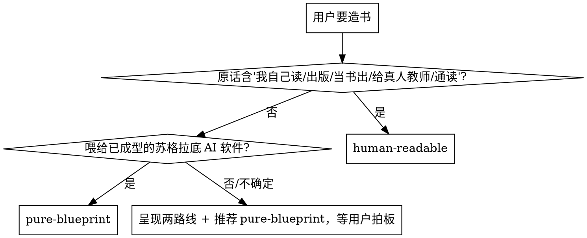

# 亲手造属于你自己的教材（Craft Your Textbook）

<SUBAGENT-STOP>
如果你是被分派来执行某个具体任务（如"写第 3 章""跑某章独立审计"）的 subagent，且不涉及造书的全局决策，则无需把完整流程再读一遍——直接按主 agent 已定稿的写作规范（风格与语法）/ 章内板块语法执行你的章节任务即可。你仍受不变量底线（references/invariants.md）约束。
</SUBAGENT-STOP>

<EXTREMELY-IMPORTANT>
本 skill 一旦命中即强制执行其流程约束，不可绕过。即便你"只是先看看""先探索一下项目结构""先问个澄清问题"，只要任务在本 skill 触发范围内，就必须先按本 skill 的 **Trigger Contract** 动作，再决定下一步。

**三条 Iron Law（违反即返工）**：

1. **先出设计，再写正文**——设计期的**确认点**（含章节安排）全部通过之前，禁止写任何章正文。**确认点＝流程停下来等你独立拍板的那一站；通过＝你明确认可，不是"我觉得可以"**。每一步的确认点问什么、按什么顺序推进，见本文档「核心：教学设计五步」。
2. **先写金标准，再并行铺章**——没有一章通过四层审计 + 试教（条件触发）并回填写作规范，禁止启动并行铺章。
3. **交付前必拆脚手架**——带脚手架元信息（写作规范标题、审计批注、未决 TODO、loader 指令外壳）的书不得交付；成品书必须是纯净可读本体。

三个阶段与推进顺序见本文档「核心：教学设计五步」。不套模板：Agent 自己设计书的形状。模式库是菜单不是套餐，读完 `references/patterns/README.md` 后强制回答"拒绝/选中每个模式各自对应本书哪个教学问题"，写在写作规范里。
</EXTREMELY-IMPORTANT>

## 这是什么

造书 = 为学习者制备一份**教材**。有两种形态（触发后必选，见下"第一步：定路线"）：

- **pure-blueprint**：给 AI 苏格拉底老师读的教学蓝本（pedagogical spec），结构化、含元指令
- **human-readable**：给人读的流畅教材，AI 拿到也能直接教

三方分工决定所有下游规则：

| 角色 | 做什么 | 看到什么 |
| --- | --- | --- |
| **用户（学习者）** | 跟 AI 老师对话学习 | 只看到对话（blueprint）或读教材+对话（human-readable） |
| **AI 老师** | 读书，用引导式提问教学 | 读完整本书作为输入 |
| **书（造物）** | 教学素材 | 是 AI 老师的输入，或人读的教材 |

**最常见的根本错误**：把书写成"给读者感受的文学作品"——开篇钩子写给谁看？"你"指谁？写每一块前先问："AI 老师/人读到这块会怎么用它？"书对 AI 老师的四个功能：①**内容锚定**（防跑题/幻觉）②**知识结构**（推理主线）③**弹药库**（案例随取随用）④**提问路线图**（引导学生抵达知识点的问题方向）。

## 何时用

- 用户要把教材/领域知识做成 AI 能教的书或人读的教材；或说"造一本书""做一本教材""按这套方法写 XX"；或需要从上传的材料（原件或已转出的转换稿）加工出结构化教学素材。

**第一步：定路线**（触发后必须问，不替用户默认）：
> "这本书是喂给 AI 苏格拉底老师教学用的教学蓝本（推荐——AI 教学精度最高），还是一本给人读的流畅教材（AI 也能直接拿它教，但教学约束更少）？"

决策启发式：

1. 用户原话含"我自己读/出版/给别人看/当书出/通读/给真人教师/我想先通读" → human-readable
2. 书要喂给已成型的苏格拉底 AI 软件（Socratopia 等） → pure-blueprint
3. 用户不确定 → 推荐 pure-blueprint 并等拍板

> **注意**：图里"呈现两路线 + 等确认"不是捷径的默认箭头——即使命中推荐，也必须把选择摆在用户面前等拍板；路线差异和细节见 `references/two-routes.md`。

### Trigger Contract（命中即履行）

**命中本 skill 时，在做任何回复或行动之前按下表顺序完成**——这也是 Rationalization Red Flags 的解药：

1. **宣告**：先对用户说"Using dsh-craft-your-textbook to [本次造书目的]"，再进入流程。subagent 仅宣告其被分派的分片任务。
2. **读最新版**：skill 会演进，触发即读当前 SKILL.md 与所需 references，不要凭记忆走流程。
3. **建 todos**：按 `references/mechanism.md` §阶段表建 todos（本仓 dsh 形态）；skill 侧按本文档「核心：教学设计五步」的五步建 todos；每个停点一个 gate todo（进入时标 in_progress，完成标 completed）。
4. **先问路线**：完成上表后立刻执行"第一步：定路线"，拿到用户拍板再继续，不替用户默认。

## Rationalization Red Flags

这些念头出现即 **STOP**——你在合理化绕过流程：

| 念头 | 现实 |
| - | - |
| "我先快速看一眼源材料再说" | 没定路线前看源会被既有结构带偏；先问路线，再按探查段摸源 |
| "设计差不多了，先开写一章试试" | 设计期未过确认点 = Iron Law 1 违例，返工 |
| "金标准太慢，我并行写起来边写边审" | 没有 Gold-Standard 回填，并行 agent 必然漂移（Iron Law 2） |
| "这张模式卡挺好直接套上去" | 模式是菜单不是套餐；必须回答"它解决本书哪个具体教学问题" |
| "这几个教学问题通用，不用问用户拍板" | 确认点是 gate，不是建议；跳过即返工 |
| "框架定好了，这里再加一章/附录很顺手" | 防螺旋：AI 不得自行加章；先问"能不能塞进现有结构"，不能则提请用户拍板（用户要加章走定点修改/深改） |
| "脚手架留在书里也无所谓" | 不带脚手架交付（Iron Law 3）；交付前必跑拆脚手架检查：本仓＝`references/mechanism.md` §质量门（机器硬检查，没有独立 CLI 命令）／skill 侧＝`references/delivery-checklist.md` 的交付前人工自查表 |
| "我记得这套流程怎么走" | skill 会演进，触发即读当前版本 |

## Skill Priority

当与本 skill 同时命中的还有其它 skill 时：**流程类 skill 优先**——若用户想先探讨"要不要造书 / 造什么书"，先用 `grilling`（盘问）厘清意图，再回到本 skill 走流程；**调试类先诊断**——造书过程中若某章反复审不过、或脚本报错，先 `diagnosing-bugs` 定位根因，再继续铺章与收网。**造书本身是流程**：本 skill 内含路线选择与五步设计，本身就是 process skill；命中后再叠加实现类工具随之执行。

## 用户指令优先级

用户显式指令（AGENTS.md / CLAUDE.md / 直接要求）优先于本 skill，本 skill 优先于默认行为。仅当你的协作对象明确说"跳过某个停点""这次不要金标准""先不拆脚手架先给我看"时才偏离 Iron Law，偏离时必须向用户点明风险并记录在案。

## 全流程导航

先出设计，再写正文；先写一章金标准审到满意，再并行铺开。平均每本书 5-7 轮审校。阶段名、每阶段的产物、确认点与推进顺序：本仓＝`references/mechanism.md` §阶段表 与 §闸门与推进／skill 侧＝本文档「核心：教学设计五步」＋`references/audit-and-testing.md`；触发后按它建 todos，逐个停点推进。无源（从零造）不跑探查、幻觉闸门更严，仅适合 AI 知识密度高的领域；有源（按材料造）探查必走，按源数量选深度（见 `references/source-material.md`）。

**源探查这一段是「找知识点」的全程，别只做材料摘要**：按材料逐份派**精读小助手**，每份只读一份材料、交「节点＋拓扑」两节（见加载表「探查 · 精读小助手」那一行）；全部精读回来之后派**对齐小助手**处理**跨材料**的边与「同一件事在几份材料里各出现一次」（见「探查 · 跨材料对齐」）；主笔把各份两节合并成一张**《知识点清单》**——跨材料边归对齐那一档、不归任何一份精读。知识点清单是设计期与铺章的唯一锚（三套载体的分工见 `references/file-contracts.md`「知识点三套载体」一节）。

每批/每章写完，在项目约定的进度账本记一行（章号 → 完成 → 审计结论）；上下文压缩后靠它恢复进度，别靠记忆。本仓＝工作台记进度账、机器只报数不拦交工（它只报最后一条记录落在多久前、此后又交工了几章，口径见 `references/mechanism.md` §闸门与推进）／skill 侧＝主笔自己维护一份进度账（`progress.md`），没有机器读数，够不够勤由人看。

## 核心：教学设计五步

这是本 skill 的核心——Agent 不套模板，自己设计书的形状。**用户停点只在前四步**：每一步末的**确认点**是 **gate**（todo 独立跟踪，未通过不进入下一步，不靠"我觉得"过关）。**第 5 步不是用户停点**：契约产物（写作规范/铁律/风格线）必须在铺章之前写完，并被第 4 步那一次拍板一并看到——它是第 4 步的**产物前置**，不另停一次；五步编号不变，改的只是「哪里停下来等用户」。确认点的推进顺序：本仓＝`references/mechanism.md` §闸门与推进（机器顺序）／skill 侧＝本文档「核心：教学设计五步」逐节确认（`SKILL.md`）。

1. **设计第 1 步 · 分析源 + 推导目标**（不读模式库，免先入为主）：源材料形态是什么？这本书让学习者最终能做到什么（通过考试/理解概念/掌握技能/通读建体系）？学习者最大的坑是什么？**有源的书，这一步的前半是源探查**：逐份派精读小助手交「节点＋拓扑」两节 → 全部回来后派对齐小助手补跨材料的边与「同一件事」合并 → 主笔合并成《知识点清单》（方法见加载表「探查 · 精读小助手」「探查 · 跨材料对齐」两行；⛔ 不是自己边读边记）。**本步的确认点**：目标和坑是否准确。**这 3–5 条交的是内容，不是文件名**：交到设计期产物里（本仓＝`stage-submit(stage=goal, goals=[…])`，一条一句纯字符串、载体与版本号由机器现算落盘／skill 侧＝把这几条写进写作规范或独立的《学习目标》一节（`META.md`），文件名由主笔定）——⛔ 不指定文件名、不自己写那份文件。3–5 条是提示不是硬拦：材料只撑得起 2 条就写 2 条，⛔ 不为凑数编。
2. **设计第 2 步 · 路线决策**（见"第一步：定路线"）。
3. **设计第 3 步 · 模式选型 + 板块语法设计**：读 `references/patterns/README.md` 理解模式库；带第 1 步的教学问题翻卡（每张卡判断"这个问题本书有没有"）；回答两个强制问题写进写作规范（style-spec）：本仓＝`工作区/style-spec.md`／skill 侧＝`META.md`（风格与语法另立 `style-spec.md`，或并入同一份）——① 考虑过哪些模式、拒绝了哪些、为什么拒绝？② 所选每个模式对应本书哪个具体教学问题？可选：从预装配包（认证/叙事/K-12）出发再定制；设计章内板块语法（必含/循环/可选板块、叙事约定、章末教学区）。**本步的确认点**：模式选型和板块语法是否合理。
4. **设计第 4 步 · 整书教学架构设计**：知识链主线、卷/部划分、逐章骨架；特殊功能章（地基章/收网章）；跨章引用机制、附录汇编策略；贯穿案例/主角约定；回填源材料索引第二层（章级映射）。**本步的确认点**：全书架构和逐章骨架——契约产物（写作规范/铁律/风格线）要在本步拍板之前写完，随本步结果一并给用户看；它不再单独停一次。
5. **设计第 5 步 · 契约产物完稿（不是用户停点）**：写作规范（契约与铁律 + 风格与语法两节）完成，必答问题见 `references/file-contracts.md`；章节骨架完成；源材料索引完成；**风格线**（用户随时补的写法意见）按 `references/file-contracts.md`「风格线」一节落盘——一条一行、追加式。不变量底线见 `references/invariants.md`——任何设计都不能违反。本步只是第 4 步拍板的**产物前置**，不单独停下来等用户确认。

## 主笔纪律

这六条与工作台那套铁律里「与账本／工具无关」的那一半同源，改写掉了账本与工具名，只留对话里也成立的行为：

1. **交付前三查**：用户意见、风格意见、进度行——三样都处置完才交。
2. **派完小助手必留收尾说明**：说清在等谁、自设检查点，不许用户催。
3. **进度行只叙述已发生的事实**：不承诺还没发生的事（`progress.md` 那行会被原样读到）。
4. **范例章走干净审计**：审计小助手给结论，主笔**逐条回权威源核实后**裁决，不照单全收；点名条目回灌执笔。
5. **不代用户拍板**：拍板／回退／删除／改名，一律先复述、等用户明确同意。
6. **先把用户的决定记进 `progress.md` 再回话**，不口头承诺。

> **对齐不了的那一半**：本仓＝机器放行、账本、可恢复续跑与界面画廊；skill 侧＝没有这些，交付检查器只告诉你红不红。⛔ 别把 skill 侧读成等于工作台——强制力不在同一条线上。

## 可选支线：把书造薄（源探查之后、章节骨架之前）

> **可选，不是默认**：用户选「按材料全覆盖」或「先起骨架后面再砍」时，这条支线**完全不出现**。
> 它只服务一种请求——「这本书太厚了，先确认读者已经会什么，再决定哪些不造」。

**入口话术**（设计期、源探查之后、章节骨架之前问）：

> 这本书要造多厚？①按材料全覆盖（默认）②**把书造薄**——先出问卷确认读者已经会什么、哪些不造，我据此削掉一部分知识点 ③先按全覆盖起骨架，后面再砍。

选 ①③ 时这条支线完全不出现。

**三份产物（都落在书项目根，⛔ 不进 `resources/`）**。⚠️ 第 1 份 `知识点图.md` 是**skill 独有扩展**，与主线的《知识点清单》、工作台的知识地图指同一件事（对照表见 `references/file-contracts.md`「知识点三套载体」一节）：

1. **`知识点图.md`** —— 三节：
   - `## 节点`：`key`／知识点／可判（一句能判「会／不会」的话）／出处（材料＋小节＋行段）／把握（强／中／待核）／标记；
   - `## 拓扑`：`from`／`to`／类型（`prereq`／`alias`／`see-also`）／依据；
   - `## 削减记录`：`key`／档（`已经会`／`不需要`）／依据（题号或原话）／将影响（哪章少一个点、哪个前置不再讲）。
2. **`削减问卷.md`** —— 六类问题：① 读者程度 ② 本书目标 ③ 按图分片问「已经会」 ④ 哪些不造 ⑤ 篇幅／时间上限 ⑥ 有无「讲但不必深讲」的中间态。
3. **写作规范里的「读者边界」一句**：`读者已会：A、B、C；本书不覆盖：D、E`。下游写作 agent 与跨章审计**只读这一句，不读图**——图是给人看与回滚用的。

**规则**：

- **只标记不删行**：削掉的卡留在节点表里带标记，可放回；⛔ 不删行、⛔ 不改 key。
- **`prereq` 才有拓扑语义**：无环、无自环、不能双向；`alias`／`see-also` 允许成环、不进门槛。
- **把握档三档**（强／中／待核）：最弱那档的 `prereq` 不算门槛、也不算已定。
- **AI 四步**：① 逐条映射答卷→削减记录（必写依据：题号或原话；映射不出记 `待核`，⛔ 不猜成「已会」）② 定档 `已经会`（下沿）／`不需要`（上沿），两档不许混 ③ 重算门槛与上端前沿，**削完新露出的上端要回头问用户一句** ④ 产出净知识点集 `全图 − 已经会 − 不需要`，它同时是章节骨架第 5 列的锚定清单与覆盖自查的尺子。
- **孤岛只点名**：⛔ 不设孤岛率上限、⛔ 不为了好看编边。
- **问卷技能依赖是软的**：`/to-questionnaire` 可用时用它生成；**不可用时按六问直接问，一题一段**——⛔ 不写成硬依赖（终端用户不一定装那套技能）。答卷不要求格式，散文、只答一半都收；映射是 AI 的活。
- **交付时必说三句**：削了几条／各哪档（数要能被人数出来）、每条依据（题号或原话，用户改哪行都算数）、受影响的章（哪章少一个点、哪个前置不再讲）。
- **这条支线在开发板没实现**（skill 独有扩展）：`知识点图.md` 只由 skill 侧主笔按本节产；本仓＝不跑「把书造薄」、也不读这份图（本仓的知识地图是另一套载体 `工作区/knowledge-map.json`，含图审校软读数与 `waivedPoints`）／skill 侧＝这三份产物（含 `知识点图.md`）就是本节的全部。三套载体（精读两节→《知识点清单》／造薄支线的 `知识点图.md`／本仓的知识地图）指同一件事，谁产谁读见 `references/file-contracts.md`「知识点三套载体」一节。

## 关键工程原则

- **金标准先行**（Iron Law 2）：没有金标准就并行 = agent 必然漂移；**一个 agent 只写一章**，避免长上下文漂移。
- **断言可追溯**：每写一条定义/公式/偏好判断，都能回源或回判断根；**深度承诺**：设计期在写作规范里声明四维深度目标（默认"中"底线），最佳范例章兑现，未兑现回炉。
- **防螺旋**：AI 不得自行加章/附录/机制板块，新需求先问"能不能塞进现有结构"；用户主动加章走定点修改（深改）。**交付前必拆脚手架**（Iron Law 3）。

## 参考文件按需加载

| 场景 | 参考文件 |
| --- | --- |
| **dsh 形态需要**（skill 侧没有工作台机器面，阶段与推进见本文档「核心：教学设计五步」；该文件不进 skill 发布包） | `references/mechanism.md` |
| **REQUIRED** 设计期 不变量底线 | `references/invariants.md` |
| **REQUIRED** 设计期 模式选型 | `references/patterns/README.md` |
| **REQUIRED** 设计期 契约产物（四件设计产物＋风格线，含风格线落点与知识点三套载体对照表） | `references/file-contracts.md` |
| 探查 | `references/source-material.md` |
| 探查 · 精读小助手（每份材料一路；只读一份、交「节点＋拓扑」两节） | `references/subagent-prompts/close-reading-prompt.md` |
| 探查 · 跨材料对齐小助手（全部精读回来后派一路；跨材料的边＋「同一件事」合并） | `references/subagent-prompts/alignment-prompt.md` |
| 探查 / 骨架前 · 知识点清单审校小助手（独立审一遍节点与拓扑的语义） | `references/subagent-prompts/graph-review-prompt.md` |
| 探查 → 骨架之间 · 合并《知识点清单》（何时做、以什么形状组织、如何去重与分配） | `references/knowledge-list-organization.md` |
| 用户要「企业职员视角讲知识、全虚构」的小说体时（human 路线下的一种写法，不是第三条路线） | `references/novel-mode.md` |
| 设计期 板块语法起点 | `references/chapter-grammar-starter.md` |
| 设计期 深度设计 / 铺章 深度审计 | `references/depth.md` |
| 设计期 路线差异 | `references/two-routes.md` |
| 铺章 审计 | `references/audit-and-testing.md` |
| 铺章 写作 subagent prompt | `references/subagent-prompts/writing-agent-prompt.md` |
| 铺章 审计 subagent prompt | `references/subagent-prompts/audit-agent-prompt.md` |
| 铺章 合并前跨章审计 subagent prompt（五项核对判定词与判定口径的**唯一起处**） | `references/subagent-prompts/cross-audit-prompt.md` |
| 铺章 范例章（金标准）执笔 subagent prompt | `references/subagent-prompts/gold-writing-agent-prompt.md` |
| 铺章 范例章（金标准）审计 subagent prompt | `references/subagent-prompts/gold-audit-prompt.md` |
| 审计派单模板（章级 L1-L3 与范例章两份模板的出处；复制后机械替换占位符，不许临场编 prompt） | `references/auditor-prompt-template.md` |
| 交付 | `references/delivery-checklist.md` |
| 避坑 | `references/anti-patterns.md` |
| 设计期 模式卡 · 概念锚定类（五张，逐张判断「这个问题本书有没有」） | `references/patterns/concept-anchoring/precise-definition.md`、`references/patterns/concept-anchoring/misconception.md`、`references/patterns/concept-anchoring/socratic-questioning.md`、`references/patterns/concept-anchoring/fact-vs-judgment.md`、`references/patterns/concept-anchoring/depth-elaboration.md` |
| 设计期 模式卡 · 评估/练习类（六张） | `references/patterns/assessment/judgment-card.md`、`references/patterns/assessment/quick-judgment.md`、`references/patterns/assessment/application-problem.md`、`references/patterns/assessment/worked-example.md`、`references/patterns/assessment/practice-gradient.md`、`references/patterns/assessment/deterministic-anchor.md` |
| 设计期 模式卡 · 叙事结构类（三张） | `references/patterns/narrative/scenario-hook.md`、`references/patterns/narrative/running-case.md`、`references/patterns/narrative/character-protagonist.md` |
| 设计期 模式卡 · 整书架构类（六张） | `references/patterns/structure/foundation-chapter.md`、`references/patterns/structure/capstone-chapter.md`、`references/patterns/structure/cross-ref-trace.md`、`references/patterns/structure/appendix-compilation.md`、`references/patterns/structure/multi-source-arbitration.md`、`references/patterns/structure/recurring-leitmotif.md` |
| 设计期 模式卡 · 语言学习特化（一张） | `references/patterns/language-learning/vocabulary-dimension.md` |

## 一句话核心

> 书是给 AI 老师或人读的教学素材，学生主要跟 AI 老师对话。触发即宣告、建 todos、定路线；不套模板，设计期自己设计书的形状——不变量是底线、模式库是菜单、契约产物（四件设计产物＋风格线）强制回答设计问题。**先出设计再写正文，先写金标准再并行，交付前必拆脚手架。**
