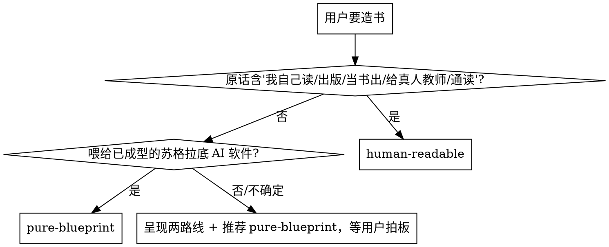

# 亲手造属于你自己的教材（Craft Your Textbook）

<SUBAGENT-STOP>
如果你是被分派来执行某个具体任务（如"写第 3 章""跑某章独立审计"）的 subagent，且不涉及造书的全局决策，则无需把完整流程再读一遍——直接按主 agent 已定稿的写作规范（风格与语法）/ 章内板块语法执行你的章节任务即可。你仍受不变量底线（references/invariants.md）约束。
</SUBAGENT-STOP>

<EXTREMELY-IMPORTANT>
本 skill 一旦命中即强制执行其流程约束，不可绕过。即便你"只是先看看""先探索一下项目结构""先问个澄清问题"，只要任务在本 skill 触发范围内，就必须先按本 skill 的 **Trigger Contract** 动作，再决定下一步。

**三条 Iron Law（违反即返工）**：

1. **先出设计，再写正文**——设计期的**确认点**（含章节安排；单位词与判据见本仓 `CONTEXT.md` 的「确认点」词条）全部通过之前，禁止写任何章正文。
2. **先写金标准，再并行铺章**——没有一章通过四层审计 + 试教（条件触发）并回填写作规范，禁止启动并行铺章。
3. **交付前必拆脚手架**——带脚手架元信息（写作规范标题、审计批注、未决 TODO、loader 指令外壳）的书不得交付；成品书必须是纯净可读本体。

机器名与路径见 `references/mechanism.md`。不套模板：Agent 自己设计书的形状。模式库是菜单不是套餐，读完 `references/patterns/README.md` 后强制回答"拒绝/选中每个模式各自对应本书哪个教学问题"，写在写作规范里。
</EXTREMELY-IMPORTANT>

## 这是什么

造书 = 为学习者制备一份**教材**。有两种形态（触发后必选，见下"第一步：定路线"）：

- **pure-blueprint**：给 AI 苏格拉底老师读的教学蓝本（pedagogical spec），结构化、含元指令
- **human-readable**：给人读的流畅教材，AI 拿到也能直接教

三方分工决定所有下游规则：

| 角色 | 做什么 | 看到什么 |
| --- | --- | --- |
| **用户（学习者）** | 跟 AI 老师对话学习 | 只看到对话（blueprint）或读教材+对话（human-readable） |
| **AI 老师** | 读书，用引导式提问教学 | 读完整本书作为输入 |
| **书（造物）** | 教学素材 | 是 AI 老师的输入，或人读的教材 |

**最常见的根本错误**：把书写成"给读者感受的文学作品"——开篇钩子写给谁看？"你"指谁？写每一块前先问："AI 老师/人读到这块会怎么用它？"书对 AI 老师的四个功能：①**内容锚定**（防跑题/幻觉）②**知识结构**（推理主线）③**弹药库**（案例随取随用）④**提问路线图**（引导学生抵达知识点的问题方向）。

## 何时用

- 用户要把教材/领域知识做成 AI 能教的书或人读的教材；或说"造一本书""做一本教材""按这套方法写 XX"；或需要从上传的材料（原件或已转出的转换稿）加工出结构化教学素材。

**第一步：定路线**（触发后必须问，不替用户默认）：
> "这本书是喂给 AI 苏格拉底老师教学用的教学蓝本（推荐——AI 教学精度最高），还是一本给人读的流畅教材（AI 也能直接拿它教，但教学约束更少）？"

决策启发式：

1. 用户原话含"我自己读/出版/给别人看/当书出/通读/给真人教师/我想先通读" → human-readable
2. 书要喂给已成型的苏格拉底 AI 软件（Socratopia 等） → pure-blueprint
3. 用户不确定 → 推荐 pure-blueprint 并等拍板

> **注意**：图里"呈现两路线 + 等确认"不是捷径的默认箭头——即使命中推荐，也必须把选择摆在用户面前等拍板；路线差异和细节见 `references/two-routes.md`。

### Trigger Contract（命中即履行）

**命中本 skill 时，在做任何回复或行动之前按下表顺序完成**——这也是 Rationalization Red Flags 的解药：

1. **宣告**：先对用户说"Using dsh-craft-your-textbook to [本次造书目的]"，再进入流程。subagent 仅宣告其被分派的分片任务。
2. **读最新版**：skill 会演进，触发即读当前 SKILL.md 与所需 references，不要凭记忆走流程。
3. **建 todos**：按 `references/mechanism.md` §阶段表建 todos；每个停点一个 gate todo（进入时标 in_progress，完成标 completed）。
4. **先问路线**：完成上表后立刻执行"第一步：定路线"，拿到用户拍板再继续，不替用户默认。

## Rationalization Red Flags

这些念头出现即 **STOP**——你在合理化绕过流程：

| 念头 | 现实 |
| - | - |
| "我先快速看一眼源材料再说" | 没定路线前看源会被既有结构带偏；先问路线，再按探查段摸源 |
| "设计差不多了，先开写一章试试" | 设计期未过确认点 = Iron Law 1 违例，返工 |
| "金标准太慢，我并行写起来边写边审" | 没有 Gold-Standard 回填，并行 agent 必然漂移（Iron Law 2） |
| "这张模式卡挺好直接套上去" | 模式是菜单不是套餐；必须回答"它解决本书哪个具体教学问题" |
| "这几个教学问题通用，不用问用户拍板" | 确认点是 gate，不是建议；跳过即返工 |
| "框架定好了，这里再加一章/附录很顺手" | 防螺旋：AI 不得自行加章；先问"能不能塞进现有结构"，不能则提请用户拍板（用户要加章走定点修改/深改） |
| "脚手架留在书里也无所谓" | 不带脚手架交付（Iron Law 3）；交付前必跑拆脚手架检查，判据见 `references/mechanism.md` §质量门（机器硬检查，没有独立 CLI 命令） |
| "我记得这套流程怎么走" | skill 会演进，触发即读当前版本 |

## Skill Priority

当与本 skill 同时命中的还有其它 skill 时：**流程类 skill 优先**——若用户想先探讨"要不要造书 / 造什么书"，先用 `grilling`（盘问）厘清意图，再回到本 skill 走流程；**调试类先诊断**——造书过程中若某章反复审不过、或脚本报错，先 `diagnosing-bugs` 定位根因，再继续铺章与收网。**造书本身是流程**：本 skill 内含路线选择与五步设计，本身就是 process skill；命中后再叠加实现类工具随之执行。

## 用户指令优先级

用户显式指令（AGENTS.md / CLAUDE.md / 直接要求）优先于本 skill，本 skill 优先于默认行为。仅当你的协作对象明确说"跳过某个停点""这次不要金标准""先不拆脚手架先给我看"时才偏离 Iron Law，偏离时必须向用户点明风险并记录在案。

## 全流程导航

先出设计，再写正文；先写一章金标准审到满意，再并行铺开。平均每本书 5-7 轮审校。阶段名、每阶段的产物、闸门与推进顺序全部以 `references/mechanism.md` §阶段表 与 §闸门与推进 为准；触发后按它建 todos，逐个停点推进。无源（从零造）不跑探查、幻觉闸门更严，仅适合 AI 知识密度高的领域；有源（按材料造）探查必走，按源数量选深度（见 `references/source-material.md`）。

每批/每章写完，在项目约定的进度账本记一行（章号 → 完成 → 审计结论）；上下文压缩后靠它恢复进度，别靠记忆。机器只报数、不拦交工：它只报最后一条进度记录落在多久前、此后又交工了几章，够不够勤由人看（口径与边界见 `references/mechanism.md` §闸门与推进）。

## 核心：教学设计五步

这是本 skill 的核心——Agent 不套模板，自己设计书的形状。每步末的**确认点**是 **gate**（todo 独立跟踪，未通过不进入下一步，不靠"我觉得"过关）。确认点与拍板的机器顺序见 `references/mechanism.md` §闸门与推进。

1. **设计第 1 步 · 分析源 + 推导目标**（不读模式库，免先入为主）：源材料形态是什么？这本书让学习者最终能做到什么（通过考试/理解概念/掌握技能/通读建体系）？学习者最大的坑是什么？**本步的确认点**：目标和坑是否准确。**这 3–5 条交的是内容，不是文件名**：走交工交上去（`stage-submit(stage=goal, goals=[…])`，一条一句纯字符串），载体与版本号由机器现算落盘——⛔ 不指定文件名、不自己写那份文件。3–5 条是提示不是硬拦：材料只撑得起 2 条就写 2 条，⛔ 不为凑数编。
2. **设计第 2 步 · 路线决策**（见"第一步：定路线"）。
3. **设计第 3 步 · 模式选型 + 板块语法设计**：读 `references/patterns/README.md` 理解模式库；带第 1 步的教学问题翻卡（每张卡判断"这个问题本书有没有"）；回答两个强制问题写进写作规范（style-spec，`工作区/style-spec.md`）——① 考虑过哪些模式、拒绝了哪些、为什么拒绝？② 所选每个模式对应本书哪个具体教学问题？可选：从预装配包（认证/叙事/K-12）出发再定制；设计章内板块语法（必含/循环/可选板块、叙事约定、章末教学区）。**本步的确认点**：模式选型和板块语法是否合理。
4. **设计第 4 步 · 整书教学架构设计**：知识链主线、卷/部划分、逐章骨架；特殊功能章（地基章/收网章）；跨章引用机制、附录汇编策略；贯穿案例/主角约定；回填源材料索引第二层（章级映射）。**本步的确认点**：全书架构和逐章骨架。
5. **设计第 5 步 · 契约产物完稿**：写作规范（契约与铁律 + 风格与语法两节）完成，必答问题见 `references/file-contracts.md`；章节骨架完成；源材料索引完成。不变量底线见 `references/invariants.md`——任何设计都不能违反。

## 关键工程原则

- **金标准先行**（Iron Law 2）：没有金标准就并行 = agent 必然漂移；**一个 agent 只写一章**，避免长上下文漂移。
- **断言可追溯**：每写一条定义/公式/偏好判断，都能回源或回判断根；**深度承诺**：设计期在写作规范里声明四维深度目标（默认"中"底线），最佳范例章兑现，未兑现回炉。
- **防螺旋**：AI 不得自行加章/附录/机制板块，新需求先问"能不能塞进现有结构"；用户主动加章走定点修改（深改）。**交付前必拆脚手架**（Iron Law 3）。

## 参考文件按需加载

| 场景 | 参考文件 |
| --- | --- |
| **REQUIRED** 任何阶段需要精确机器名/路径/动作 | `references/mechanism.md` |
| **REQUIRED** 设计期 不变量底线 | `references/invariants.md` |
| **REQUIRED** 设计期 模式选型 | `references/patterns/README.md` |
| **REQUIRED** 设计期 四文件契约 | `references/file-contracts.md` |
| 探查 | `references/source-material.md` |
| 设计期 板块语法起点 | `references/chapter-grammar-starter.md` |
| 设计期 深度设计 / 铺章 深度审计 | `references/depth.md` |
| 设计期 路线差异 | `references/two-routes.md` |
| 铺章 审计 | `references/audit-and-testing.md` |
| 铺章 写作 subagent prompt | `references/subagent-prompts/writing-agent-prompt.md` |
| 铺章 审计 subagent prompt | `references/subagent-prompts/audit-agent-prompt.md` |
| 铺章 合并前跨章审计 subagent prompt（五项核对判定词与判定口径的**唯一起处**） | `references/subagent-prompts/cross-audit-prompt.md` |
| 交付 | `references/delivery-checklist.md` |
| 避坑 | `references/anti-patterns.md` |

## 一句话核心

> 书是给 AI 老师或人读的教学素材，学生主要跟 AI 老师对话。触发即宣告、建 todos、定路线；不套模板，设计期自己设计书的形状——不变量是底线、模式库是菜单、四文件契约强制回答设计问题。**先出设计再写正文，先写金标准再并行，交付前必拆脚手架。**
